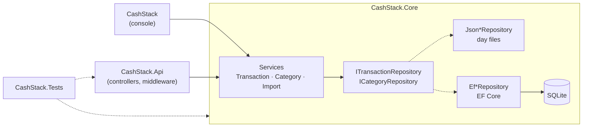

# CashStack

A budget tracker in **C# / .NET 10**: record income and expenses, organise them in
categories and get reports with totals per category for any date range. It comes as a
**console app** and a **REST API** on top of one shared core library, with **SQLite via
Entity Framework Core** (or JSON files) as storage and **82 automated tests**.

My first C# project, built during the WBS Coding School "Software Engineering & AI"
program (requirements FR001–FR016 plus the course topics REST API, middleware, filters,
error handling and EF Core).

## Features

**Console**
- Add income or expenses: choose a category from a numbered list, enter description and amount (`42,50` or `42.50`)
- Remove a transaction from a numbered list (with confirmation)
- Report for a date range with an optional type filter: income, expenses, balance and totals per category
- Input validation with retry: invalid input never crashes the menu

**REST API** (`/api/v1`)
- Transactions: list (date range, type and category filter), get, create, delete, summary per category
- Categories: list, get, create, rename, delete, with business rules (unique names, protected "Other", no delete while in use)
- Consistent error responses as RFC 9457 `ProblemDetails` (400 / 404 / 409 / 500)
- CORS policy for the front end, request timing middleware, action filter for date ranges

**Under the hood**
- Two storage providers behind the same interfaces: **SQLite** (EF Core, migrations at startup) and **JSON** files, selected by configuration
- Every added transaction is written to an audit log via a C# event
- One-time, idempotent import of existing JSON data into SQLite

## Getting started

Requires the [.NET 10 SDK](https://dotnet.microsoft.com/download).

```bash
git clone https://github.com/MonkeyDNaara/CashStack.git
cd CashStack
dotnet test
```

**API** (http://localhost:5198, run from the project folder):

```bash
cd src/CashStack.Api
dotnet run --launch-profile http
```

**Console**:

```bash
cd src/CashStack
dotnet run
```

On the first start the database `data/cashstack.db` is created and migrated
automatically, including the starter categories. `data/` and `logs/` are created in the
folder you start the app from (both are gitignored).

Example requests for every endpoint and status code:
[`src/CashStack.Api/CashStack.Api.http`](src/CashStack.Api/CashStack.Api.http)
(runs in VS Code with the REST Client extension or in Rider / Visual Studio).

## Configuration

Both apps read the same keys from their `appsettings.json`:

| Key | Default | Meaning |
|---|---|---|
| `Storage:Provider` | `Sqlite` | `Sqlite` (EF Core) or `Json` (one file per day) |
| `ConnectionStrings:CashStack` | `Data Source=data/cashstack.db` | SQLite database file |
| `Storage:DataDirectory` | `data` | Folder for the JSON provider |
| `Storage:LogDirectory` | `logs` | Folder for `transactions.log` |
| `Cors:AllowedOrigins` | `["http://localhost:5173"]` | Front-end origins (API only) |

An unknown provider stops the app at startup with exit code 1 and a clear message.

## REST API

| Method | Route | Success | Errors |
|---|---|---|---|
| `GET` | `/api/v1/transactions?from=&to=&type=&categoryId=` | 200 | 400 |
| `GET` | `/api/v1/transactions/summary?from=&to=` | 200 | 400 |
| `GET` | `/api/v1/transactions/{id}` | 200 | 404 |
| `POST` | `/api/v1/transactions` | 201 + `Location` | 400 |
| `DELETE` | `/api/v1/transactions/{id}` | 204 | 404 |
| `GET` | `/api/v1/categories?type=` | 200 | 400 |
| `GET` | `/api/v1/categories/{id}` | 200 | 404 |
| `POST` | `/api/v1/categories` | 201 + `Location` | 400, 409 duplicate name |
| `PUT` | `/api/v1/categories/{id}` | 200 | 400, 404, 409 duplicate / protected |
| `DELETE` | `/api/v1/categories/{id}` | 204 | 404, 409 protected / in use |

`from` and `to` are `yyyy-MM-dd`; without them the current month up to today is used.

**Create a transaction**

```http
POST /api/v1/transactions
Content-Type: application/json

{ "type": "Expense", "categoryId": "6f0b8a52-1c3e-4c1a-9a51-000000000201", "description": "Weekly shopping", "amount": 42.50 }
```

```json
{
  "id": "a1d982e2-bf8d-4ee3-ab4d-64876d4826b0",
  "timestamp": "2026-11-10T10:04:28.2942+01:00",
  "type": "Expense",
  "categoryId": "6f0b8a52-1c3e-4c1a-9a51-000000000201",
  "categoryName": "Groceries",
  "description": "Weekly shopping",
  "amount": 42.50
}
```

**Summary** (`GET /api/v1/transactions/summary`): totals plus one entry per used category,
ready for a chart.

```json
{
  "from": "2026-11-01", "to": "2026-11-10",
  "income": 2500, "expenses": 852.5, "balance": 1647.5,
  "categories": [
    { "categoryId": "6f0b8a52-…-000000000101", "name": "Salary", "type": "Income", "total": 2500 },
    { "categoryId": "6f0b8a52-…-000000000202", "name": "Rent", "type": "Expense", "total": 800 },
    { "categoryId": "6f0b8a52-…-000000000201", "name": "Groceries", "type": "Expense", "total": 52.5 }
  ]
}
```

**Errors** use `ProblemDetails`. Messages of our own business rules are safe to show in the
UI; internal details (stack traces, file paths) only go to the server log.

```json
{
  "type": "https://tools.ietf.org/html/rfc9110#section-15.5.10",
  "title": "Conflict",
  "status": 409,
  "detail": "An Expense category named 'rent' already exists.",
  "instance": "/api/v1/categories",
  "traceId": "00-d7e1d74a7ac57d6b5dd17…"
}
```

| Exception | Status | Detail |
|---|---|---|
| Model validation (DataAnnotations, date range filter) | 400 | field errors |
| `BusinessRuleException` (unknown category, wrong type) | 400 | our message |
| `ConflictException` (duplicate, protected, in use) | 409 | our message |
| `ArgumentException` from the domain | 400 | generic text |
| `StorageException`, anything else | 500 | generic text |

**Middleware pipeline** (in this order): request timing → CORS → exception handler →
status code pages → routing → controllers (model validation, `[ValidateDateRange]` filter).

## Console

```
--- Add transaction ---
Type (i = income, e = expense): e
Categories (Expense):
  1) Groceries
  2) Health
  3) Leisure
  4) Other
  5) Rent
  6) Transport
Category number: 1
Description: Weekly shopping
Amount: 42,50
Added: 2026-11-10 10:09 | Expense | Groceries       |     -42.50 | Weekly shopping

--- Report ---
2026-11-01 to 2026-11-10 | All types
  1) 2026-11-10 10:09 | Expense | Groceries       |     -42.50 | Weekly shopping
  2) 2026-11-10 10:09 | Expense | Rent            |    -800.00 | November rent
  3) 2026-11-10 10:09 | Income  | Salary          |   +2500.00 | Salary

Summary for this period (all types):
  Income:        2500.00
  Expenses:       842.50
  Balance:       1657.50

By category:
  Income  | Salary               |     +2500.00
  Expense | Rent                 |      -800.00
  Expense | Groceries            |       -42.50
```

Categories are managed through the API; the console only selects them.
Dates use `yyyy-MM-dd`, Enter accepts the default shown in brackets.

**Import old JSON data** into the database (idempotent, safe to run twice):

```bash
cd src/CashStack
dotnet run -- --import-json
```

## Storage

**SQLite (default)** – two tables, `Categories 1 ── n Transactions`:

| Decision | Why |
|---|---|
| `Amount` stored as whole cents (`INTEGER`) | SQLite has no decimal type; text would sort `"10" < "9"` and cannot be summed |
| `Timestamp` stored as binary ticks | sortable, keeps the UTC offset |
| Shadow column `Day` (local date) | the date filter matches the JSON storage (one file per local day) |
| Unique index `(Type, Name)` with `NOCASE` | "Rent" and "rent" cannot both exist |
| Foreign key with `Restrict` | a category in use cannot be deleted |
| Starter categories seeded with fixed ids | `Other` per type is protected and the fallback for transactions without category |

The schema is created by the EF Core migration `InitialCreate` at startup.
`dotnet tool restore` installs the `dotnet-ef` tool for new migrations.

**JSON** – one human-readable file per day plus `categories.json`:

```
data/
├── 2026-10-16.json      # [ { "id", "timestamp", "type", "categoryId", "description", "amount" } ]
└── categories.json
logs/
└── transactions.log     # 2026-10-16 16:29:22 +02:00 | ADDED | Expense |      42.50 | Groceries | 3f2b…
```

## Architecture



```
src/
├── CashStack.Core/           # shared library, no UI
│   ├── Models/               # Transaction, Category, DefaultCategories, TransactionSummary, CategoryTotal
│   ├── Repositories/         # interfaces + JSON and EF Core implementations
│   ├── Data/                 # CashStackDbContext, entity configurations, migrations
│   ├── Services/             # TransactionService, CategoryService, ImportService, LoggerService
│   ├── Configuration/        # StorageSettings, StorageProvider
│   ├── Exceptions/           # StorageException, DomainException → BusinessRule / Conflict
│   └── Events/               # TransactionAddedEventArgs
├── CashStack/                # console app (Program.cs, appsettings.json)
└── CashStack.Api/            # ASP.NET Core Web API
    ├── Controllers/  Dtos/  Extensions/  Middleware/  Filters/  Validation/  ErrorHandling/
tests/
└── CashStack.Tests/          # xUnit
```

**Design decisions**
- **Dependency inversion:** services only know the repository interfaces; the storage is chosen in the composition root (`Program.cs` / `AddCashStackStorage`).
- **Rich domain model:** `Transaction` and `Category` validate themselves in their constructors; `Transaction` is immutable, a category can only be renamed.
- **Business rules in services, not controllers:** controllers stay thin; domain exceptions are mapped to HTTP status codes in one place (`GlobalExceptionHandler`).
- **Scoped lifetimes:** one `DbContext`, repository set and service instance per request; scope validation is on in every environment.
- **Events:** `TransactionService` raises `TransactionAdded`, the `LoggerService` subscribes, so services don't know about logging.
- `decimal` for money, `CultureInfo.InvariantCulture` for parsing and formatting.

Class and sequence diagrams: [docs/planning/UML.md](docs/planning/UML.md) ·
Plan and requirements: [docs/planning/PLANNING.md](docs/planning/PLANNING.md)

## Tests

```bash
dotnet test
```

82 tests (xUnit), no files left on disk:

| Area | How |
|---|---|
| Models | constructor validation |
| Services | hand-written in-memory fakes of the repository interfaces |
| Repositories | **contract tests**: one abstract test class per interface, run against JSON (temp folder per test) and EF Core (SQLite in-memory with the real migration) |
| API | `WebApplicationFactory` in memory: status codes, error format, CORS, audit log |

## Status

| Epic | Status |
|---|---|
| MVP console app (FR001–FR016): models, storage, events, logging, UI, error handling | ✅ |
| REST API: Core library, hosting, controllers, middleware, validation, filters, error handling, CORS | ✅ |
| Persistence with EF Core: SQLite, categories, provider switch, import, tests | ✅ |
| Front end (React + Vite + TypeScript) | 🚧 next |

## Workflow

Planned epic by epic on a [GitHub project board](https://github.com/users/MonkeyDNaara/projects/8):
one branch and one pull request per issue, Conventional Commits, PRs linked to their issues.
