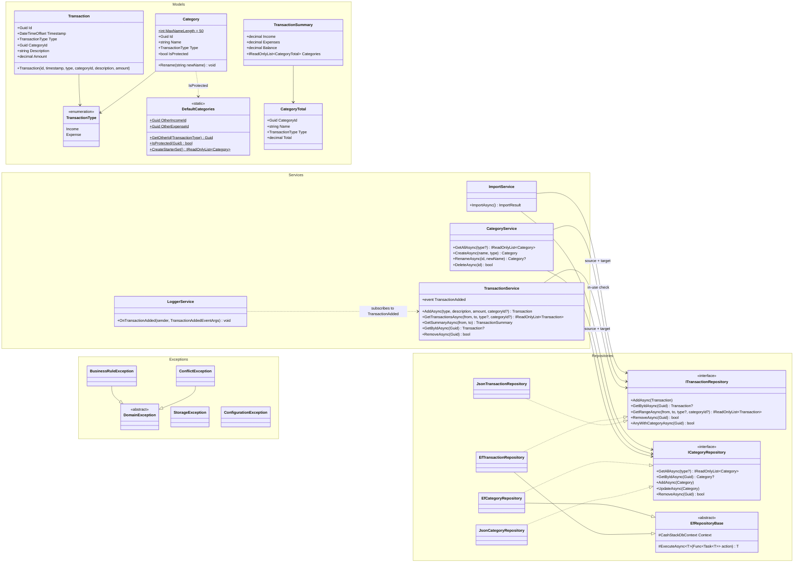
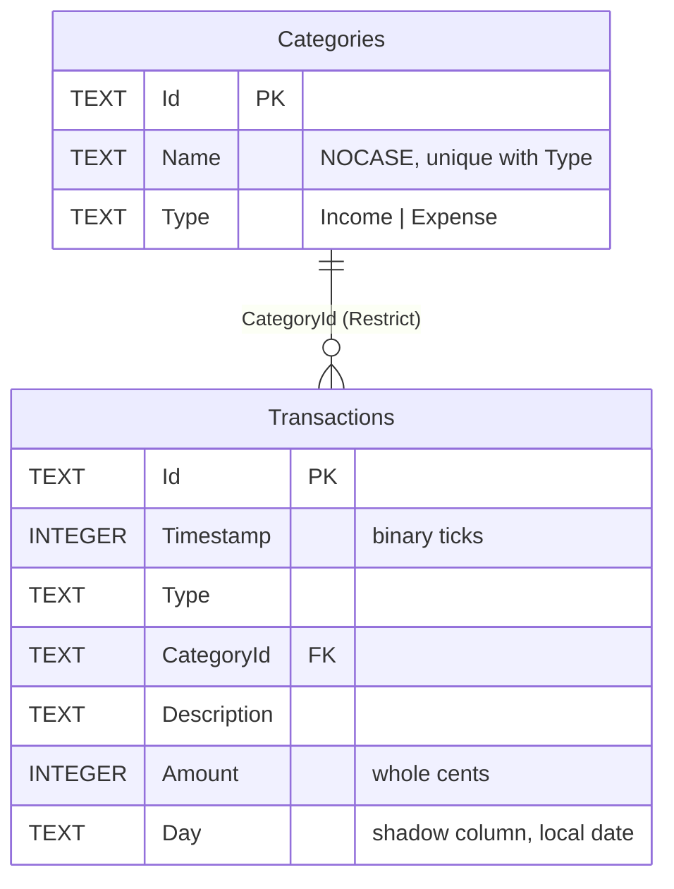
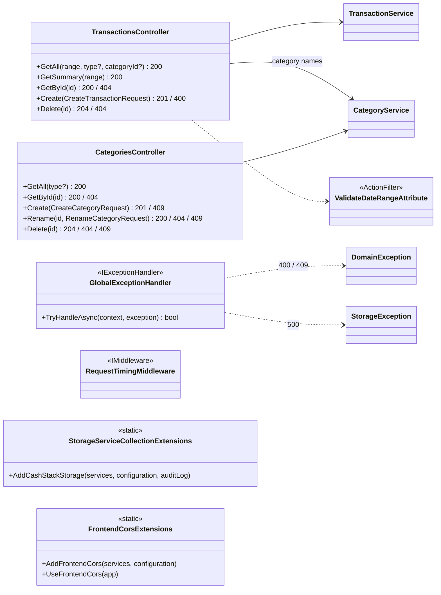
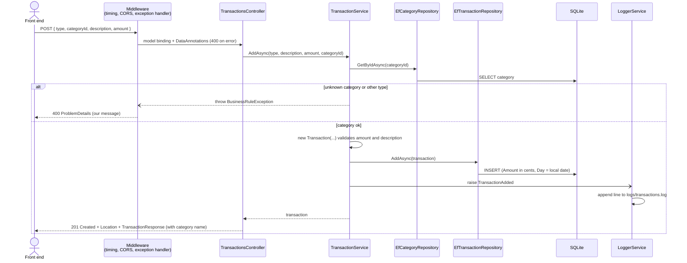
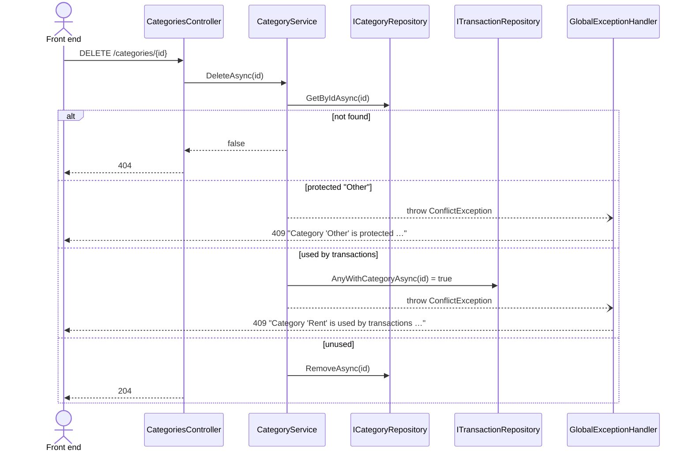

# CashStack – UML

Current design (after Epic 11, EF Core). Signatures are shortened: `CancellationToken`
parameters and `async` return types (`Task<…>`) are left out for readability.

## Class diagram: Core

**Reading the arrows:** `-->` uses · `..|>` implements · `--|>` inherits · `..>` depends on ·
`+` public · `#` protected · `$` static.

**Key rule:** services only depend on the two repository interfaces. The JSON and the EF
Core implementations are exchangeable (chosen by `Storage:Provider`) and are verified by
the same contract tests.

## Database (SQLite)

## Class diagram: API

## Sequence: POST /api/v1/transactions (SQLite)

## Sequence: DELETE /api/v1/categories/{id} (category in use)

